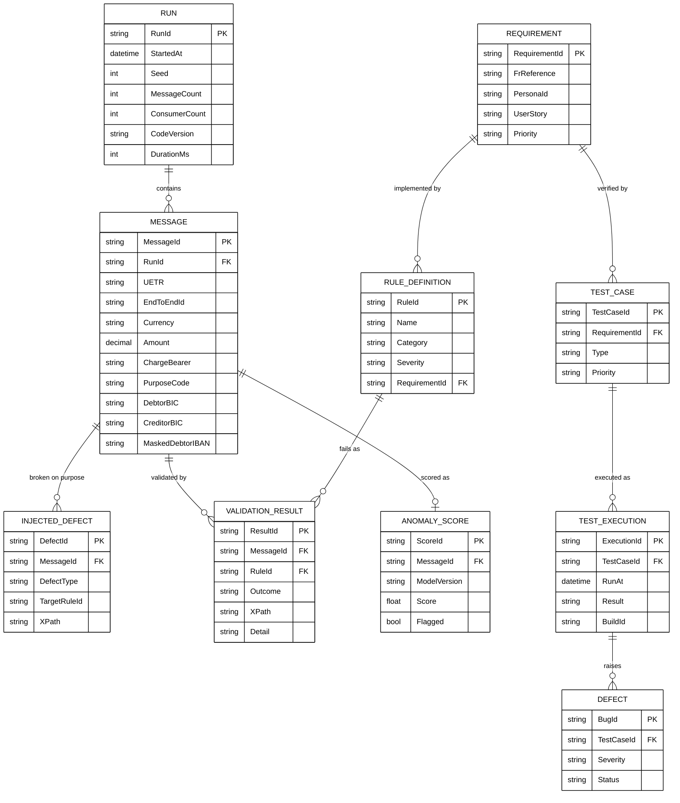
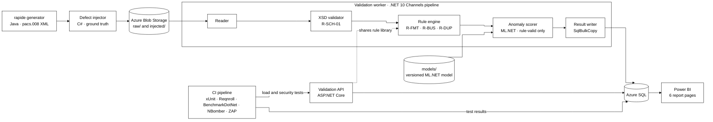
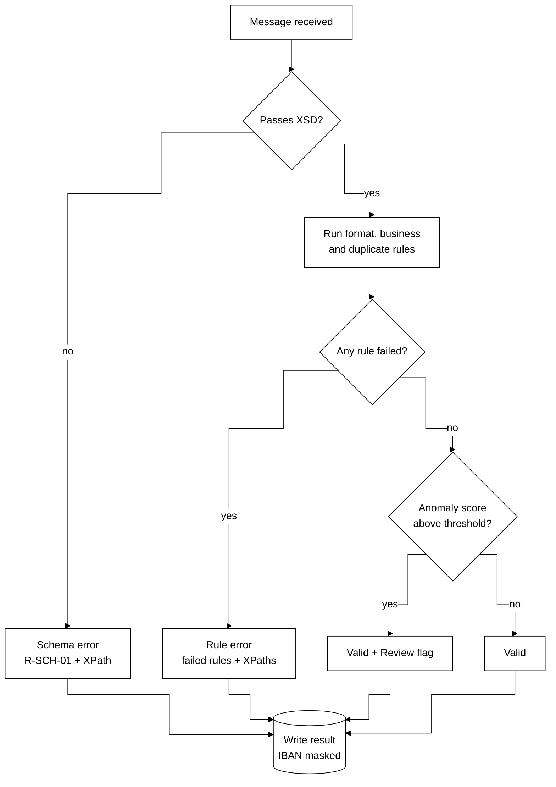

# ISO 20022 Payment Message Validator (iso20022-pacs008-validator): Parallel C# Validation, QA Test Management and Power BI Reporting for pacs.008 Credit Transfers

## Project Description

**iso20022-pacs008-validator** is a quality assurance (QA) and validation platform for ISO 20022 **pacs.008** (FI-to-FI Customer Credit Transfer) messages. It generates 5,000+ synthetic messages with the AWS **rapide** generator, injects controlled defects as ground truth, validates every message in parallel with a **C# (.NET 10)** engine against the official XSD (XML Schema Definition) and a catalog of payment business rules, and reports validation quality, performance, security and test coverage in **Power BI**.

The project mirrors how banks and payment processors check ISO 20022 messages before settlement, and is built on Azure services common in banking and insurance. All data is synthetic: no real customer data, live SWIFT (Society for Worldwide Interbank Financial Telecommunication) connectivity or licensed BIC (Business Identifier Code) directories are used.

---

## Tech Stack

| Category | Tools / Services |
|----------|------------------|
| **Programming Language** | C# (.NET 10) for validation, API and tests; Java (JDK 11+) for the rapide generator |
| **Message Generation** | AWS rapide ISO 20022 generator (Spring Boot, MIT-0 licence) |
| **Validation Engine** | `System.Xml.Schema.XmlSchemaSet`, `System.Threading.Channels`, `SqlBulkCopy` |
| **API** | ASP.NET Core minimal API on Azure App Service or Azure Container Apps |
| **Storage** | Azure Blob Storage (raw and injected XML), Azure SQL Database (runs, results, tests) |
| **Secrets** | Azure Key Vault |
| **Testing** | xUnit, Reqnroll (BDD, behaviour-driven development), Testcontainers, BenchmarkDotNet, NBomber, OWASP ZAP |
| **CI/CD** | GitHub Actions or Azure DevOps Pipelines (continuous integration and delivery) |
| **Reporting** | Power BI Desktop (Power BI Service if a licence is available) |
| **Anomaly Scoring** | ML.NET (randomized PCA anomaly detection on rule-valid messages), `Microsoft.Extensions.ML` `PredictionEnginePool` |

---

## Solution Pathways

iso20022-pacs008-validator improves confidence in payment message quality by:

- **Catching defects before settlement:** schema and business-rule checks classify every message as Valid, Schema error or Rule error, with the failed rule and its XPath location.
- **Measuring detection accuracy:** injected defects act as ground truth, so detection rate and false-positive rate are measured, not assumed.
- **Proving performance under parallelism:** throughput is benchmarked at 1, 2, 4 and 8 consumers, with identical results required for the same seed.
- **Making testing auditable:** every test case traces to a requirement in the Requirements Traceability Matrix (RTM), and results flow into Power BI.
- **Flagging unusual but valid payments:** an ML.NET anomaly scorer marks rule-valid messages with unusual amounts, corridors or currency pairs for review, without ever rejecting them.
- **Testing security on its own deployment:** OWASP ZAP (Open Worldwide Application Security Project Zed Attack Proxy) scans the API for authentication, injection and data-exposure issues.

---

## Introduction & Project Context

### Problem Statement

ISO 20022 is replacing older payment message formats across SWIFT cross-border payments and many domestic clearing systems. A pacs.008 message carries dozens of structured fields (parties, agents, amounts, charges, identifiers), and a single malformed field can cause a payment to be rejected, repaired manually or delayed. Payment teams need validation that is accurate, fast at batch volume, and fully traceable for audit.

### Market Scope & Industry Context

- **Banks and payment processors** validate ISO 20022 messages at ingestion, before routing and settlement.
- **Payment gateways and acquirers** map card and account transactions into ISO 20022 structures for interbank settlement.
- **Technology risk and audit teams** need evidence that validation controls, data masking and security testing are in place.

### Research Objectives

| ID | Objective | Measure |
|----|-----------|---------|
| OBJ-1 | Catch injected defects | Detection rate of injected defects, target ≥ 99% |
| OBJ-2 | Avoid false alarms on clean messages | False-positive rate, target ≤ 1% |
| OBJ-3 | Show the gain from parallel processing | Messages per second, single-threaded vs multi-consumer |
| OBJ-4 | Prove requirements are tested | Share of requirements linked to a passing test, target 100% |
| OBJ-5 | Keep the API secure under test | No high-severity OWASP ZAP findings open at release |

Targets are provisional until the first baseline run.

---

## Dataset Description & Data Sources

### Sources

| Source | Content | Volume | Access |
|--------|---------|--------|--------|
| [AWS rapide ISO 20022 generator](https://github.com/aws-samples/iso20022-message-generator) | Synthetic pacs.008 XML with randomised charge bearer, purpose codes, parties, BICs and currencies | Set with `-n` (5,000+ per run) | Free, MIT-0 licence |
| ISO 20022 message definitions (iso20022.org) | Official pacs.008 XSD schema | One pinned version | Free |
| Fictitious BIC and LEI (Legal Entity Identifier) reference lists | Format-valid identifiers for `application.yaml` | 50–200 entries | Created for this project |

Real BIC and LEI directories are licensed, so only fictitious, format-valid identifiers are used.

### Generator Configuration — `application.yaml`

rapide is configured through `application.yaml`:

```yaml
# generator/application.yaml (illustrative; confirm keys against the rapide repo)
purposeCodes: [CASH, SALA, SUPP, TRAD, INTC]
currencyCodes: [USD, EUR, GBP, AED, PHP, JPY]
sourceBics: generator/reference/bics_source.csv
destinationBics: generator/reference/bics_destination.csv
```

```bash
# Build and generate 5,000 messages into a run folder
./gradlew clean build
cd pacs008
./rapide-iso20022 -n 5000 -d ../../data/raw/run-001 -o pacs008
```

### Raw Message Store — `Blob Storage`

| Path | Content |
|------|---------|
| `raw/{runId}/` | Messages exactly as rapide generated them |
| `injected/{runId}/` | Copies after defect injection (the validator's input) |
| `results/{runId}/` | Optional per-run JSON export of results |

### Relational Schema — `Azure SQL`



`LOAD_TEST_RESULT` (scenario, requests per second, p50/p95/p99 latency, error rate) and `SECURITY_FINDING` (scan date, OWASP category, severity, endpoint, status) are stored alongside and joined to test cases by `TestCaseId`.

---

## Pre-Processing Methodology

### Data Preparation

1. Generate a batch with rapide using a fixed seed and run ID.
2. Upload the raw batch to `raw/{runId}/`.
3. Run the **defect injector**: mutate a configurable share of messages (for example 10%), one known defect per mutated message, and record each in `INJECTED_DEFECT`.
4. Upload the injected batch to `injected/{runId}/` as the validator's input.

### Data Cleaning

The validator never "cleans" messages: a payment message is either valid or rejected with reasons. Cleaning applies only to the extracted analytics layer (FR-12), where valid messages are flattened to CSV (comma-separated values).

#### Issues Anticipated

| Issue | Effect | Handling |
|-------|--------|----------|
| rapide output may not match the newest XSD version | Clean messages fail schema validation | Pin one schema version; baseline a clean run before injecting defects |
| Random fields may not cover every rule | Some rules never fail | Inspect the first batch; add targeted injections per rule |
| Malformed or truncated files | Run stops | Log as a failed message; continue (NFR-05) |
| Duplicate identifiers across runs | False duplicate alerts | Duplicate checks are scoped to a single run (R-DUP-01) |

### Feature Engineering — Field Extraction

Key fields are parsed from each message into `MESSAGE` for reporting: `MsgId`, `UETR`, `EndToEndId`, currency, amount, charge bearer, purpose code, debtor and creditor agent BICs, and a **masked** debtor IBAN (International Bank Account Number), showing only the last four characters.

---

## Validation & Rule Methodology

### Schema validation

Every message is validated against the pinned pacs.008 XSD with `XmlSchemaSet` (R-SCH-01). Business rules run only when schema validation passes.

### Business rule catalog

| Rule ID | Check | Category | Traces to |
|---------|-------|----------|-----------|
| R-SCH-01 | Message conforms to the pacs.008 XSD | Schema | FR4 |
| R-FMT-01 | BIC is 8 or 11 characters in ISO 9362 format | Format | FR5 |
| R-FMT-02 | IBAN passes the ISO 13616 mod-97 checksum | Format | FR5 |
| R-FMT-03 | Currency is a valid ISO 4217 code | Format | FR5 |
| R-FMT-04 | Amount uses the currency's allowed decimal places (for example JPY has 0) | Format | FR5 |
| R-FMT-05 | UETR (Unique End-to-end Transaction Reference) is a valid UUID version 4 | Format | FR5 |
| R-BUS-01 | Amount is greater than zero | Business | FR6 |
| R-BUS-02 | Number of transactions (`NbOfTxs`) equals the transactions present | Business | FR6 |
| R-BUS-03 | Control sum (`CtrlSum`), when present, equals the sum of amounts | Business | FR6 |
| R-BUS-04 | Charge bearer is one of DEBT, CRED, SHAR, SLEV | Business | FR6 |
| R-BUS-05 | Purpose code is in the configured code list | Business | FR6 |
| R-BUS-06 | Settlement date is not before the creation date | Business | FR6 |
| R-BUS-07 | Debtor agent and creditor agent are not the same BIC | Business | FR6 |
| R-DUP-01 | `MsgId`, `EndToEndId` and UETR are unique within the run | Duplicate | FR7 |
| R-SEC-01 | No unmasked IBAN appears in logs or API output | Security | FR10 |

Open question: confirm which charge-bearer and purpose-code values the pinned pacs.008 version allows before finalising R-BUS-04 and R-BUS-05.

### Defect injection & ground truth

Each injected defect targets one rule (for example, an IBAN with a wrong check digit targets R-FMT-02). Because ground truth is stored separately from validator output, every run produces a confusion matrix per rule.

A second injection type, **statistical anomalies**, creates messages that pass every rule but are unusual (for example an amount many times the corridor's median, or a rare currency pair). These are labelled `DefectType = ANOMALY` and are used only to evaluate the anomaly scorer.

### Statistical approach

| Metric | Formula |
|--------|---------|
| Detection rate (recall) | Injected defects caught ÷ injected defects |
| False-positive rate | Clean messages flagged ÷ clean messages |
| Precision | True flags ÷ all flags |
| Throughput | Messages validated ÷ run duration (seconds) |
| Parallel consistency | Result sets identical for the same seed at 1 and N consumers (NFR-03) |
| Anomaly AUC | Area under the ROC (receiver operating characteristic) curve on `ANOMALY` injections, from ML.NET `AnomalyDetection.Evaluate` |
| Anomaly detection rate | Anomalies flagged at the chosen threshold ÷ anomalies injected, with the false-positive count reported alongside |

---

## Historical Data & Run Filtering

Every run is reproducible from its seed (FR13). Power BI filters by `RunId`, run date, code version, consumer count and currency, so results can be compared across code changes.

---

## API & Data Export

| Method | Endpoint | Description |
|--------|----------|-------------|
| `POST` | `/validate` | Validate one pacs.008 message; returns outcome, failed rules and XPaths (IBANs masked) |
| `GET` | `/runs/{runId}` | Summary of a batch run: counts by outcome, detection rate, duration |
| `GET` | `/runs/{runId}/results` | Paged rule failures for a run |
| `GET` | `/runs/{runId}/export.csv` | Flattened extract of valid messages (FR12) |

All endpoints require authentication (SR2) and reject oversized payloads and XML external entities (SR3).

---

## Running Locally

```bash
# 1. Generate messages (Java 11+)
make generate N=5000 RUN=run-001

# 2. Inject defects (10% of messages)
make inject RUN=run-001 RATE=0.10

# 3. Validate with 8 consumers, results to local SQL Server (Docker)
make validate RUN=run-001 CONSUMERS=8

# 4. Run all tests
make test

# 5. Start the API
make api
```

### Generating more messages locally

Increase `-n` (for example `make generate N=50000`) to stress-test the worker; compare throughput at 1, 2, 4 and 8 consumers with `make bench`.

---

## Project Structure

```
iso20022-pacs008-validator/
├── generator/                      # rapide build scripts, application.yaml, fictitious BIC/LEI lists
│   ├── application.yaml
│   ├── reference/
│   └── run_rapide.sh
├── schemas/                        # pinned pacs.008 XSD
├── src/
│   ├── Iso20022.Core/              # message model, masking, shared types
│   ├── Iso20022.Rules/             # rule catalog (one class per rule)
│   ├── Iso20022.Injector/          # defect injector + ground-truth writer
│   ├── Iso20022.Anomaly/           # ML.NET feature pipeline, training and scoring
│   ├── Iso20022.Worker/            # Channels pipeline: reader → XSD → rules → anomaly scorer → writer
│   └── Iso20022.Api/               # ASP.NET Core API
├── tests/
│   ├── Iso20022.Rules.Tests/       # xUnit unit tests per rule
│   ├── Iso20022.Anomaly.Tests/     # feature extraction and scoring tests
│   ├── Iso20022.Integration.Tests/ # Testcontainers end-to-end tests
│   ├── Iso20022.Specs/             # Reqnroll Given/When/Then scenarios
│   ├── Iso20022.Benchmarks/        # BenchmarkDotNet
│   ├── load/                       # NBomber scenarios
│   └── security/                   # OWASP ZAP configuration
├── qa/                             # personas, RTM, test cases, defect log, test report (CSV + XLSX)
├── models/                         # versioned ML.NET model files (.zip)
├── sql/                            # schema and seed scripts
├── powerbi/                        # .pbix report and theme
├── infra/                          # Bicep or Terraform for Azure resources
├── demo/                           # screenshots and demo recording
├── .github/workflows/ci.yml
├── Makefile
├── .env.example
├── .gitignore
└── README.md
```

---

## Validation Pipeline

### `generator/run_rapide.sh` — Message Generation

Builds rapide, generates `N` pacs.008 messages with a fixed seed, and uploads them to `raw/{runId}/`.

### `src/Iso20022.Injector` — Defect Injection

Mutates a configurable share of messages, one defect per message, each targeting one rule, and writes `INJECTED_DEFECT` rows as ground truth.

### `src/Iso20022.Worker` — Parallel Validation

A `System.Threading.Channels` pipeline with four stages:

| Stage | Work | Parallelism |
|-------|------|-------------|
| Reader | Streams files from `injected/{runId}/` | 1–2 producers |
| XSD validator | R-SCH-01 | N consumers (configurable, NFR4) |
| Rule engine | R-FMT, R-BUS, R-DUP, R-SEC rules | N consumers |
| Anomaly scorer | ML.NET score for messages that passed every rule | N consumers via `PredictionEnginePool` |
| Result writer | Batched `SqlBulkCopy` inserts | 1 writer |

Bounded channels cap memory; duplicate detection uses a `ConcurrentDictionary` scoped to the run. ML.NET's `PredictionEngine` is not thread-safe, so consumers draw engines from a `PredictionEnginePool` instead of sharing one.

### `src/Iso20022.Anomaly` — Anomaly Scoring

Rules decide whether a message is valid; the anomaly scorer only adds a **Review** flag to valid messages that look unusual. It never rejects a message, so every rejection stays explainable by a rule.

| Step | Detail |
|------|--------|
| Features | Log of amount, currency, corridor (debtor and creditor country from BIC characters 5–6), currency pair, charge bearer, purpose code, creation hour |
| Encoding | One-hot encoding for categorical fields, normalisation for numeric fields (ML.NET transforms) |
| Training | `MLContext.AnomalyDetection.Trainers.RandomizedPca` (unsupervised) on clean, rule-valid messages from a baseline run |
| Scoring | Each rule-valid message gets a score; above the threshold → `Flagged = true` (Review) |
| Threshold | Set from the baseline score distribution (for example the top 1%), tuned against `ANOMALY` injections |
| Evaluation | `MLContext.AnomalyDetection.Evaluate`: AUC and detection rate at a fixed false-positive count |
| Versioning | Model saved as `models/anomaly-v{n}.zip`; `ModelVersion` stored with every score |

Results go to `ANOMALY_SCORE` and appear in the Power BI **Anomalies** page.

### `src/Iso20022.Api` — Validation API

Reuses `Iso20022.Rules`, so a rule is written and tested once and behaves identically in batch and API modes.

---

## Testing Process

The test artefacts follow a six-part structure: **Personas → Requirements & Acceptance Criteria → Requirements Traceability Matrix → Test Cases → Bug Reports / Defect Log → Test Execution Report**. Each is kept in `qa/` as CSV and XLSX, and execution results are exported from CI into Azure SQL for Power BI.

### Techniques Used

| Level | Tool | Covers | Exit criterion |
|-------|------|--------|----------------|
| Unit | xUnit | Every rule: pass, fail, boundary | All rules covered; 100% pass |
| Integration | xUnit + Testcontainers | Pipeline end to end on a 100-message sample | Results match injected ground truth |
| BDD | Reqnroll | Given/When/Then acceptance criteria | Scenario for every High-priority requirement |
| Performance | BenchmarkDotNet, NBomber | Throughput by consumer count; API steady, spike and soak load | NFR1–NFR3 measured and reported |
| Security | OWASP ZAP | Authentication, injection, XXE, data exposure on own deployment | No open High findings |

### Personas

| Persona ID | Name | Role | Contact/Team | Goals & Access | Key Modules/Features | Technical Level |
|------------|------|------|--------------|----------------|----------------------|-----------------|
| P001 | Payments Operations Analyst | Operations user (internal) | Payments Operations, Workflows 1–4 | Knows which messages fail and why before they are released; reads results, cannot change rules | Batch run results, rule failures by XPath, CSV export | Intermediate |
| P002 | Compliance / Technology Risk Reviewer | Control reviewer (internal) | Technology Risk, Workflow 4 | Needs evidence that masking, validation and audit trails are tested | Masking checks, RTM coverage, audit fields | Intermediate |
| P003 | QA / Security Tester | QA and penetration tester (internal) | QA Team, Workflows 5–6 | Probes the API for injection, authentication and data-exposure flaws; runs load tests | `POST /validate`, ZAP scans, NBomber scenarios | Advanced |
| P004 | Integration Developer | API consumer (internal) | Integration Team, Workflow 5 | Calls the API from upstream systems and needs fast, consistent responses | `POST /validate`, `GET /runs/{runId}` | Advanced |

### Requirements & Acceptance Criteria

**Payments Operations Analyst (P001)**

| Req ID | Module/Category | Persona | Requirement / User Story | Given | When | Then | Priority |
|--------|-----------------|---------|--------------------------|-------|------|------|----------|
| REQ-ISO-001 | Message Generation & Injection | P001 | As an analyst, I need a reproducible batch of pacs.008 messages so I can compare results across runs. | rapide is built and `application.yaml` is configured | A run is started with `-n 5000` and seed 42 | 5,000 files appear in `raw/run-001/`; re-running with seed 42 gives identical files | High |
| REQ-ISO-002 | Message Generation & Injection | P001 | As an analyst, I need known defects injected so detection accuracy can be measured. | A raw batch exists | The injector runs at a 10% rate | About 500 messages are mutated; one `INJECTED_DEFECT` row per mutation | High |
| REQ-ISO-003 | Schema Validation | P001 | As an analyst, I need every message checked against the pacs.008 XSD so malformed messages are rejected. | The pinned XSD is loaded | A message missing a mandatory element is validated | Outcome is Schema error with R-SCH-01 and the element's XPath | High |
| REQ-ISO-004 | Schema Validation | P001 | As an analyst, I need clean messages to pass so I am not chasing false alarms. | A clean, unmodified message | It is validated | Outcome is Valid; no rule failures | High |
| REQ-ISO-005 | Business Rule Validation | P001 | As an analyst, I need identifier formats checked (BIC, IBAN, UETR) so routing does not fail. | A message with an IBAN whose check digits are wrong | It is validated | R-FMT-02 fails with the IBAN's XPath; the IBAN is masked in the output | High |
| REQ-ISO-006 | Business Rule Validation | P001 | As an analyst, I need currency and amount rules checked so settlement amounts are correct. | A JPY message with a decimal amount | It is validated | R-FMT-04 fails | High |
| REQ-ISO-007 | Business Rule Validation | P001 | As an analyst, I need header totals reconciled so batch counts match. | `NbOfTxs` or `CtrlSum` disagrees with the transactions | It is validated | R-BUS-02 or R-BUS-03 fails | High |
| REQ-ISO-008 | Business Rule Validation | P001 | As an analyst, I need charge bearer and purpose codes checked against allowed lists. | A message with charge bearer `XXXX` | It is validated | R-BUS-04 fails | Medium |
| REQ-ISO-009 | Duplicate Detection & Masking | P001 | As an analyst, I need duplicate messages flagged so a payment is not sent twice. | Two messages in a run share a UETR | The run is validated | The second message fails R-DUP-01 | High |

**Compliance / Technology Risk Reviewer (P002)**

| Req ID | Module/Category | Persona | Requirement / User Story | Given | When | Then | Priority |
|--------|-----------------|---------|--------------------------|-------|------|------|----------|
| REQ-ISO-010 | Duplicate Detection & Masking | P002 | As a reviewer, I need account numbers masked in logs and API output so sensitive data is not exposed. | A run containing IBANs has completed | Logs and API responses are searched for full IBANs | No full IBAN is found; only the last four characters appear | High |
| REQ-ISO-011 | Reporting & Traceability | P002 | As a reviewer, I need every result traceable to run, message, rule and code version. | A run has completed | A validation result is opened | `RunId`, `MessageId`, `RuleId` and `CodeVersion` are present | Medium |
| REQ-ISO-012 | Reporting & Traceability | P002 | As a reviewer, I need RTM coverage shown in Power BI so untested requirements are visible. | CI has exported test executions | The RTM coverage page is opened | Each requirement shows Passed, Failed or Not run | Medium |

**QA / Security Tester (P003) and Integration Developer (P004)**

| Req ID | Module/Category | Persona | Requirement / User Story | Given | When | Then | Priority |
|--------|-----------------|---------|--------------------------|-------|------|------|----------|
| REQ-ISO-013 | API & Integration | P004 | As a developer, I need to validate a single message over the API. | The API is running and I hold a valid key | I `POST` a valid message to `/validate` | `200 OK` with outcome Valid | High |
| REQ-ISO-014 | API & Integration | P004 | As a developer, I need batch and API results to agree. | The same message is in a batch run | It is also sent to `/validate` | Both return the same outcome and failed rules | Medium |
| REQ-SEC-001 | Performance & Security | P003 | As the system, the API must reject unauthenticated requests. | The API is running | A request is sent with no key or token | `401 Unauthorized`; nothing is validated or logged with message content | High |
| REQ-SEC-002 | Performance & Security | P003 | As the system, the API must block XML external entity (XXE) payloads. | The API is running | A message with an external entity declaration is sent | Request rejected; no external resource is fetched | High |
| REQ-SEC-003 | Performance & Security | P003 | As the system, the API must reject oversized payloads. | The payload limit is configured | A 10 MB body is sent | `413 Payload Too Large` | Medium |
| REQ-PERF-001 | Performance & Security | P003 | As a tester, I need throughput measured by consumer count to show the gain from parallelism. | A 5,000-message batch | The worker runs at 1, 2, 4 and 8 consumers | Messages per second recorded for each; results identical across runs | High |
| REQ-PERF-002 | Performance & Security | P003 | As a tester, I need API latency measured under load. | The API is deployed | NBomber runs steady, spike and soak scenarios | p50, p95 and p99 latency and error rate are recorded | Medium |

### Requirements Traceability Matrix

**REQUIREMENTS TRACEABILITY MATRIX — ISO 20022 pacs.008 Validator**

| Module / Category | FR Reference | Requirement ID | Persona ID | Requirement / User Story | Test Case IDs | Priority | Owner | Execution Result | Defect ID |
|-------------------|--------------|----------------|------------|--------------------------|---------------|----------|-------|------------------|-----------|
| **WORKFLOW 1 — Message Generation & Defect Injection** | | | | | | | | | |
| Message Generation & Injection | FR1 | REQ-ISO-001 | P001 | Reproducible batch of pacs.008 messages | TC-001, TC-002 | High | Gabrielle Ysabel Almirol | Not run | |
| Message Generation & Injection | FR3 | REQ-ISO-002 | P001 | Known defects injected as ground truth | TC-003, TC-004 | High | Gabrielle Ysabel Almirol | Not run | |
| **WORKFLOW 2 — Schema Validation** | | | | | | | | | |
| Schema Validation | FR4 | REQ-ISO-003 | P001 | Malformed messages rejected by XSD | TC-005, TC-006 | High | Gabrielle Ysabel Almirol | Not run | |
| Schema Validation | FR4 | REQ-ISO-004 | P001 | Clean messages pass | TC-007 | High | Gabrielle Ysabel Almirol | Not run | |
| **WORKFLOW 3 — Business Rule Validation** | | | | | | | | | |
| Business Rule Validation | FR5 | REQ-ISO-005 | P001 | BIC, IBAN and UETR formats checked | TC-008, TC-009, TC-010 | High | Gabrielle Ysabel Almirol | Not run | |
| Business Rule Validation | FR5 | REQ-ISO-006 | P001 | Currency and amount precision checked | TC-011, TC-012 | High | Gabrielle Ysabel Almirol | Not run | |
| Business Rule Validation | FR6 | REQ-ISO-007 | P001 | Header totals reconciled | TC-013, TC-014 | High | Gabrielle Ysabel Almirol | Not run | |
| Business Rule Validation | FR6 | REQ-ISO-008 | P001 | Charge bearer and purpose codes checked | TC-015 | Medium | Gabrielle Ysabel Almirol | Not run | |
| **WORKFLOW 4 — Duplicate Detection & Data Masking** | | | | | | | | | |
| Duplicate Detection & Masking | FR7 | REQ-ISO-009 | P001 | Duplicate messages flagged | TC-016 | High | Gabrielle Ysabel Almirol | Not run | |
| Duplicate Detection & Masking | FR10 | REQ-ISO-010 | P002 | Account numbers masked in logs and API | TC-017 | High | Gabrielle Ysabel Almirol | Not run | |
| **WORKFLOW 5 — API, Reporting & Traceability** | | | | | | | | | |
| API & Integration | FR8 | REQ-ISO-013 | P004 | Single-message validation over API | TC-018 | High | Gabrielle Ysabel Almirol | Not run | |
| API & Integration | FR8 | REQ-ISO-014 | P004 | Batch and API results agree | TC-019 | Medium | Gabrielle Ysabel Almirol | Not run | |
| Reporting & Traceability | FR9 | REQ-ISO-011 | P002 | Results traceable to run, rule and version | TC-020 | Medium | Gabrielle Ysabel Almirol | Not run | |
| Reporting & Traceability | FR11 | REQ-ISO-012 | P002 | RTM coverage shown in Power BI | TC-021 | Medium | Gabrielle Ysabel Almirol | Not run | |
| **WORKFLOW 6 — Performance & Security** | | | | | | | | | |
| Performance & Security | NFR1, NFR3 | REQ-PERF-001 | P003 | Throughput by consumer count, consistent results | TC-022, TC-023 | High | Gabrielle Ysabel Almirol | Not run | |
| Performance & Security | NFR2 | REQ-PERF-002 | P003 | API latency under load | TC-024 | Medium | Gabrielle Ysabel Almirol | Not run | |
| Performance & Security | SR2 | REQ-SEC-001 | P003 | Unauthenticated requests rejected | TC-025 | High | Gabrielle Ysabel Almirol | Not run | |
| Performance & Security | SR3 | REQ-SEC-002 | P003 | XXE payloads blocked | TC-026 | High | Gabrielle Ysabel Almirol | Not run | |
| Performance & Security | SR3 | REQ-SEC-003 | P003 | Oversized payloads rejected | TC-027 | Medium | Gabrielle Ysabel Almirol | Not run | |

**FR / NFR / SR reference list**

| Ref | Requirement |
|-----|-------------|
| FR1 | Generate N pacs.008 messages with rapide and store them per run |
| FR2 | Configure rapide via `application.yaml` (purpose codes, currencies, fictitious BICs) |
| FR3 | Inject controlled defects and record ground truth |
| FR4 | Validate every message against the pinned pacs.008 XSD |
| FR5 | Apply format rules (BIC, IBAN, UETR, currency, amount precision) |
| FR6 | Apply business rules (totals, charge bearer, purpose code, dates, agents) |
| FR7 | Detect duplicate `MsgId`, `EndToEndId` and UETR within a run |
| FR8 | Expose `POST /validate` and `GET /runs/{runId}` |
| FR9 | Store runs, results, defects and test executions in Azure SQL |
| FR10 | Mask account numbers in logs and API responses |
| FR11 | Publish the Power BI report (quality, failures, performance, security, RTM coverage) |
| FR12 | Export valid messages to a flat CSV extract (Should) |
| FR13 | Re-run a past batch with the same seed (Should) |
| NFR1 | Report throughput at 1, 2, 4 and 8 consumers |
| NFR2 | Report API p95 latency at steady load |
| NFR3 | Identical results single-threaded and parallel for the same seed |
| NFR4 | Consumer count configurable without code changes |
| NFR5 | A malformed file never stops a run |
| NFR6 | Every result links to run, message, rule and code version |
| NFR7 | Runs within Azure free or student credits |
| SR1 | No full account numbers in logs, errors or API responses |
| SR2 | API requires authentication (Microsoft Entra ID or API key) |
| SR3 | Reject oversized payloads and XML external entities |
| SR4 | Secrets stored in Azure Key Vault |
| SR5 | Security scans run only against this project's own deployment |

### Test Cases

| Test Case ID | Test Description | Pre-conditions | Execution Steps | Expected Results | Priority | Type |
|--------------|------------------|----------------|-----------------|------------------|----------|------|
| **WORKFLOW 1 — Message Generation & Defect Injection** | | | | | | |
| TC-001 | Generate a 5,000-message batch | rapide built; `application.yaml` set | 1. Run `make generate N=5000 RUN=run-001`. 2. Count files in `raw/run-001/`. | 5,000 XML files present | High | Functional |
| TC-002 | Reproducible generation with the same seed | TC-001 passed | 1. Re-run with the same seed into `run-002`. 2. Compare file hashes. | All hashes match | Medium | Functional |
| TC-003 | Inject defects at a 10% rate | Raw batch exists | 1. Run `make inject RATE=0.10`. 2. Count `INJECTED_DEFECT` rows. | About 500 rows, one per mutated message | High | Functional |
| TC-004 | Injected defect targets its rule | TC-003 passed | 1. Pick 10 injected messages. 2. Compare `DefectType` with `TargetRuleId`. | Every defect maps to exactly one rule | Medium | Functional |
| **WORKFLOW 2 — Schema Validation** | | | | | | |
| TC-005 | Missing mandatory element | XSD loaded | 1. Remove `<MsgId>` from a valid message. 2. Validate. | Schema error, R-SCH-01, XPath of the missing element | High | Negative |
| TC-006 | Wrong data type | XSD loaded | 1. Set `<IntrBkSttlmAmt>` to text. 2. Validate. | Schema error, R-SCH-01 | High | Negative |
| TC-007 | Clean message passes | XSD loaded | 1. Validate an unmodified rapide message. | Outcome Valid; zero failures | High | Functional |
| **WORKFLOW 3 — Business Rule Validation** | | | | | | |
| TC-008 | Invalid BIC length | Schema-valid message | 1. Set debtor agent BIC to 9 characters. 2. Validate. | R-FMT-01 fails | High | Boundary |
| TC-009 | IBAN check digits wrong | Schema-valid message | 1. Change one IBAN check digit. 2. Validate. | R-FMT-02 fails; IBAN masked in output | High | Negative |
| TC-010 | UETR not a UUID v4 | Schema-valid message | 1. Replace UETR with a version 1 UUID. 2. Validate. | R-FMT-05 fails | Medium | Negative |
| TC-011 | Unknown currency code | Schema-valid message | 1. Set currency to `XYZ`. 2. Validate. | R-FMT-03 fails | High | Negative |
| TC-012 | JPY amount with decimals | Schema-valid JPY message | 1. Set amount to `1000.50`. 2. Validate. | R-FMT-04 fails | High | Boundary |
| TC-013 | `NbOfTxs` mismatch | Schema-valid message | 1. Set `NbOfTxs` to 2 with one transaction. 2. Validate. | R-BUS-02 fails | High | Negative |
| TC-014 | `CtrlSum` mismatch | Message with `CtrlSum` | 1. Change `CtrlSum` by 0.01. 2. Validate. | R-BUS-03 fails | High | Boundary |
| TC-015 | Invalid charge bearer | Schema-valid message | 1. Set charge bearer to `XXXX`. 2. Validate. | R-BUS-04 fails | Medium | Negative |
| **WORKFLOW 4 — Duplicate Detection & Data Masking** | | | | | | |
| TC-016 | Duplicate UETR in a run | Two messages prepared | 1. Give both the same UETR. 2. Validate the run. | Second message fails R-DUP-01 | High | Functional |
| TC-017 | No full IBAN in logs or API | A completed run | 1. Search logs and API responses with an IBAN regex. | Zero full IBANs found | High | Security |
| **WORKFLOW 5 — API, Reporting & Traceability** | | | | | | |
| TC-018 | Validate one message via API | API running; valid key | 1. `POST` a valid message to `/validate`. | `200 OK`, outcome Valid | High | Functional |
| TC-019 | Batch and API agree | Message from a batch run | 1. Send it to `/validate`. 2. Compare with its batch result. | Same outcome and failed rules | Medium | Integration |
| TC-020 | Result traceability fields | A completed run | 1. Query 20 random `VALIDATION_RESULT` rows. | `RunId`, `MessageId`, `RuleId`, `CodeVersion` all present | Medium | Workflow |
| TC-021 | RTM coverage in Power BI | CI export loaded | 1. Open the RTM coverage page. 2. Compare counts with the RTM. | Counts match; untested requirements listed | Medium | Workflow |
| **WORKFLOW 6 — Performance & Security** | | | | | | |
| TC-022 | Throughput by consumer count | 5,000-message batch | 1. Run `make bench` at 1, 2, 4, 8 consumers. | Messages per second recorded for each | High | Performance |
| TC-023 | Parallel consistency | TC-022 data | 1. Compare result sets at 1 and 8 consumers. | Result sets identical | High | Performance |
| TC-024 | API latency under load | API deployed | 1. Run NBomber steady, spike and soak scenarios. | p50, p95, p99 latency and error rate recorded | Medium | Load |
| TC-025 | Unauthenticated request | API running | 1. `POST` to `/validate` with no key. | `401 Unauthorized` | High | Security |
| TC-026 | XXE payload | API running | 1. `POST` a message with an external entity declaration. | Rejected; no external fetch | High | Security |
| TC-027 | Oversized payload | Payload limit set | 1. `POST` a 10 MB body. | `413 Payload Too Large` | Medium | Security |

### Bug Reports / Defect Log

**BUG REPORTS / DEFECT LOG — ISO 20022 pacs.008 Validator**

| Bug/Defect ID | Severity | Linked Test Case | Summary | Status |
|---------------|----------|------------------|---------|--------|
| **WORKFLOW 1 — Message Generation & Defect Injection** | | | | |
| **WORKFLOW 2 — Schema Validation** | | | | |
| **WORKFLOW 3 — Business Rule Validation** | | | | |
| **WORKFLOW 4 — Duplicate Detection & Data Masking** | | | | |
| **WORKFLOW 5 — API, Reporting & Traceability** | | | | |
| **WORKFLOW 6 — Performance & Security** | | | | |

No defects logged yet. Use IDs `BUG-001` onward; severity is one of **Blocker, Critical, Major, Minor**; status is one of **Open, In Progress, Fixed, Closed**.

### Test Execution Report

**TEST EXECUTION REPORT — ISO 20022 pacs.008 Validator**

**▶ Execution summary**

| Total Test Cases | Passed | Failed |
|------------------|--------|--------|
| 27 | 0 | 0 |

No formal test case has been executed yet: all 27 are Not run, because the injector and rule engine are not built. Pre-baseline smoke checks are reported separately below and do not count toward these totals.

**▶ Defect summary**

| Total Defects | Blocker | Critical | Major | Minor |
|---------------|---------|----------|-------|-------|
| 0 | 0 | 0 | 0 | 0 |

**▶ Coverage & metrics**

| Metric | Value |
|--------|-------|
| Requirements mapped | 19 |
| Test cases executed | 0 of 27 |
| Pass rate (%) | — (nothing executed; Passed ÷ Total) |
| Fail rate (%) | — (nothing executed; Failed ÷ Total) |
| Workflows covered | 0 of 6 executed (6 of 6 mapped) |

**▶ Per-module execution results**

| Workflow | Total TCs | Passed | Failed | Pass Rate | Defects/Bugs Logged | Severity |
|----------|-----------|--------|--------|-----------|---------------------|----------|
| WORKFLOW 1 — Message Generation & Defect Injection | 4 | 0 | 0 | — | 0 | — |
| WORKFLOW 2 — Schema Validation | 3 | 0 | 0 | — | 0 | — |
| WORKFLOW 3 — Business Rule Validation | 8 | 0 | 0 | — | 0 | — |
| WORKFLOW 4 — Duplicate Detection & Data Masking | 2 | 0 | 0 | — | 0 | — |
| WORKFLOW 5 — API, Reporting & Traceability | 4 | 0 | 0 | — | 0 | — |
| WORKFLOW 6 — Performance & Security | 6 | 0 | 0 | — | 0 | — |
| **TOTAL** | **27** | **0** | **0** | — | **0** | — |

**▶ Pre-baseline smoke checks (2026-11-05)**

| Check | Result | Status |
|-------|--------|--------|
| Unit tests (IBAN masking, pinned XSD compiles) | 5 of 5 passed on .NET 10 | Passed |
| SQL scripts on SQL Server 2022 in Docker | 12 tables; 19 requirements, 15 rules, 27 test cases seeded | Passed |
| API health check (`GET /healthz`) | `200 OK` | Passed |
| rapide generation, `smoke-001` | 9 of 50 files; configured countries had no rapide reference data (GAP-7) | Failed, fixed |
| rapide generation, `smoke-002` | 50 of 50 files | Passed |
| XSD check on `smoke-002` with `xmllint`, after extracting `Document` | 50 of 50 valid | Passed |
| Field checks on `smoke-002` | 0 duplicate `MsgId`, `EndToEndId` or UETR; 50 of 50 UETRs are UUID v4; 6 currencies; 23 corridors | Passed |

These checks are not TC-001 or TC-007: TC-001 requires 5,000 messages, and TC-007 requires the validator. Open issues are tracked in `qa/spec-gaps.md`.

**▶ Load testing (NBomber) and security (OWASP ZAP) results**

| Sample | Pass/Total | Avg (ms) | p95 (ms) | Status |
|--------|------------|----------|----------|--------|
| `POST /validate` — valid message, steady load | — | — | — | Not run |
| `POST /validate` — spike load | — | — | — | Not run |
| `POST /validate` — soak (1 hour) | — | — | — | Not run |
| `POST /validate` — no authentication (TC-025) | — | — | — | Not run |
| `POST /validate` — XXE payload (TC-026) | — | — | — | Not run |
| `POST /validate` — 10 MB payload (TC-027) | — | — | — | Not run |

As with any security sampler, a "failed" request on TC-025 to TC-027 is the expected, secure behaviour (the API refuses the request).

---

## Results

No baseline run has been completed. The figures below come from the 50-message `smoke-002` smoke run on 2026-11-05, which used `xmllint` for the XSD check because the C# validator is not built yet.

| Metric | Value |
|--------|-------|
| Messages generated | 50 of 50 |
| Messages validated | 50, XSD stage only; rule engine not built |
| Detection rate | Not measured; injector not built |
| False-positive rate | Not measured; 0 of 50 clean messages rejected at the XSD stage |
| Throughput at 1 / 8 consumers (msg/s) | Not measured; worker not built |
| API p95 latency at steady load (ms) | Not measured; `POST /validate` not built |
| Open High-severity ZAP findings | Not measured; no scan run |
| Anomaly scorer AUC | Not measured; scorer not built |

---

## System Methodology

### Pipeline Flowchart



### Validation Flow



### Power BI Report Pages

1. **Validation quality**: valid vs failed messages, detection rate and false-positive rate against injected defects
2. **Rule failures**: failures by rule, category and currency
3. **Performance**: throughput by consumer count, API latency percentiles by load scenario
4. **Security**: ZAP findings by OWASP category and severity, open vs fixed
5. **RTM coverage**: requirements with passing, failing or missing tests
6. **Anomalies**: flagged valid messages by corridor, currency pair and score; AUC and detection rate by model version

---

## Key Takeaways

### Design Decisions

- **Rules decide validity; ML.NET only scores anomalies**: every rejection is explained by a rule, while unusual-but-valid messages are flagged for review.
- **Ground truth stored separately** from validator output, so accuracy is measured per rule.
- **One rule library** shared by the batch worker and the API, so a rule is written and tested once.
- **Bounded Channels pipeline** with configurable consumers, verified by a parallel-consistency test.
- **Fictitious identifiers only**: no licensed BIC/LEI data and no real customer data.

### Solution Features

- 5,000+ synthetic pacs.008 messages per run, reproducible by seed
- 15-rule validation catalog with XPath-level failure reporting
- ML.NET anomaly scoring with a Review flag on unusual valid messages
- Masked account numbers across logs and API responses
- Full QA artefact set: personas, acceptance criteria, RTM, test cases, defect log and execution report
- Power BI reporting on quality, performance, security and coverage

### Phases

1. **Phase 1 — core pipeline:** build rapide, generate 5,000 messages, XSD validation, five format rules, unit tests, local SQL, first Power BI page
2. **Phase 2 — full rules and defects:** defect injector, full rule catalog, duplicate detection, Channels pipeline, BenchmarkDotNet results
3. **Phase 3 — API and cloud:** ASP.NET Core API on Azure, Azure SQL, Blob Storage, Key Vault, CI pipeline, Reqnroll scenarios
4. **Phase 4 — load, security, reporting:** NBomber and ZAP in CI, RTM export, all five Power BI pages, case study write-up
5. **Phase 5 — anomaly scoring:** `ANOMALY` injections, ML.NET training and scoring in the worker, Anomalies page in Power BI

---

## Technical Contributions

**Status:** in progress.

- Designing an end-to-end ISO 20022 pacs.008 validation platform that generates 5,000+ synthetic messages per run with the AWS rapide generator (Java, Spring Boot), injects rule-targeted and statistical-anomaly defects as stored ground truth, and validates every message in a 5-stage C# (.NET 10) `System.Threading.Channels` pipeline (reader → XSD validator → rule engine → anomaly scorer → batched `SqlBulkCopy` writer), to be benchmarked at 1, 2, 4 and 8 consumers with identical results required single-threaded and in parallel.
- Specifying a 15-rule validation catalog across schema, format, business, duplicate and security categories, covering ISO 9362 BIC format, ISO 13616 IBAN mod-97 checksums, ISO 4217 currency and decimal precision, UUID v4 UETR checks, `NbOfTxs`/`CtrlSum` reconciliation, charge-bearer and purpose-code lists, and run-scoped duplicate detection, to be shared as one library by the batch worker and an ASP.NET Core `POST /validate` API.
- Planning an ML.NET randomized PCA anomaly scorer trained on rule-valid baseline messages over 7 engineered features (log amount, currency, BIC-derived corridor, currency pair, charge bearer, purpose code, creation hour), served thread-safely through `PredictionEnginePool`, versioned per model file, and evaluated by AUC and detection rate at a fixed false-positive count, flagging unusual messages for review without overriding rule outcomes.
- Built the relational data layer: a 12-table SQL Server schema verified in Docker, linking runs, messages, injected defects, rule definitions, rule results, anomaly scores, requirements, test cases, executions and defects, with load-test and security-finding tables. Azure Blob Storage, Azure SQL and Key Vault deployment is planned, and IBAN masking to the last 4 characters is implemented and unit tested.
- Built the QA test-management foundation: 4 personas, 19 Given/When/Then requirements, a Requirements Traceability Matrix across 6 workflows, and 27 test cases spanning functional, negative, boundary, integration, performance, load and security types, to be automated with xUnit, Reqnroll, Testcontainers, BenchmarkDotNet, NBomber and OWASP ZAP in GitHub Actions. The first generator smoke run produced 50 of 50 messages valid against the CBPR+ XSD, with 0 duplicate identifiers; formal test execution is pending.
- Planning a 6-page Power BI report covering validation quality (detection and false-positive rates against ground truth), rule failures, throughput and latency percentiles, OWASP findings by severity, RTM coverage, and anomaly scores by corridor and model version.

---

## References

[1] AWS Samples. (n.d.). *ISO 20022 message generator (rapide)*. GitHub. https://github.com/aws-samples/iso20022-message-generator

[2] ISO 20022 Registration Authority. (n.d.). *ISO 20022 message definitions: pacs.008 FI-to-FI customer credit transfer*. https://www.iso20022.org/iso-20022-message-definitions

[3] SWIFT. (n.d.). *BIC: Business Identifier Code (ISO 9362)*. https://www.swift.com/standards/data-standards/bic-business-identifier-code

[4] SWIFT. (n.d.). *IBAN: International Bank Account Number (ISO 13616)*. https://www.swift.com/standards/data-standards/iban-international-bank-account-number

[5] International Organization for Standardization. (n.d.). *ISO 4217: Currency codes*. https://www.iso.org/iso-4217-currency-codes.html

[6] Davis, K., Peabody, B., & Leach, P. (2024). *RFC 9562: Universally Unique IDentifiers (UUIDs)*. IETF. https://www.rfc-editor.org/rfc/rfc9562

[7] Microsoft. (n.d.). *System.Threading.Channels library*. Microsoft Learn. https://learn.microsoft.com/dotnet/core/extensions/channels

[8] Microsoft. (n.d.). *RandomizedPcaTrainer class (ML.NET)*. Microsoft Learn. https://learn.microsoft.com/dotnet/api/microsoft.ml.trainers.randomizedpcatrainer

[9] Microsoft. (n.d.). *Deploy a model in an ASP.NET Core Web API (PredictionEnginePool)*. Microsoft Learn. https://learn.microsoft.com/dotnet/machine-learning/how-to-guides/serve-model-web-api-ml-net

[10] OWASP Foundation. (2023). *OWASP API Security Top 10 – 2023*. https://owasp.org/API-Security/editions/2023/en/0x11-t10/

[11] OWASP Foundation. (n.d.). *XML External Entity prevention cheat sheet*. https://cheatsheetseries.owasp.org/cheatsheets/XML_External_Entity_Prevention_Cheat_Sheet.html

[12] ZAP. (n.d.). *Zed Attack Proxy*. https://www.zaproxy.org/

[13] NBomber. (n.d.). *NBomber: load testing framework for .NET*. https://nbomber.com/

[14] Reqnroll. (n.d.). *Reqnroll: BDD framework for .NET*. https://reqnroll.net/

[15] BenchmarkDotNet. (n.d.). *BenchmarkDotNet documentation*. https://benchmarkdotnet.org/

[16] Testcontainers. (n.d.). *Testcontainers for .NET*. https://dotnet.testcontainers.org/
